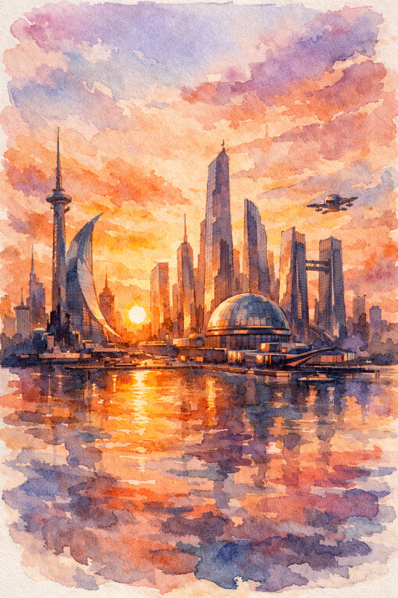
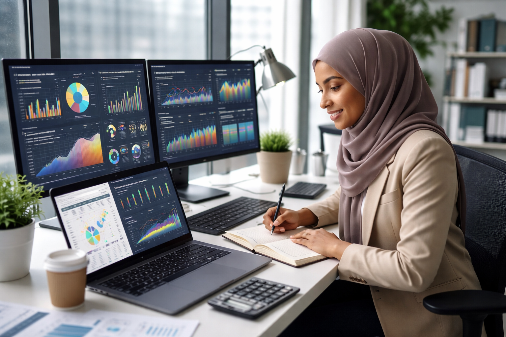

# Create prompts for models that generate images.

# Vague prompt

    Create an image of a futuristic city skyline at sunset in watercolor style.

# Model output



# Refined descriptive prompt
```
Generate a photorealistic image of a dark complexion muslim data analyst reviewing dashboards in a sleek , modern workspace. The image should clearly convey her profession, work environment and tools e.g screens, charts
```
# Model output



# Observation

    The two outputs are images representing very different artistic approaches and atmosphere. The first output focused on a general theme, there wasn't a specific perspective to follow or color pallette. The second output stuck to instruction in terms of skin tone, religion, profession, tools (screens, dashboards, charts), work environment (modern, sleek), and the activity. The second is more realistic than the first output and less vague